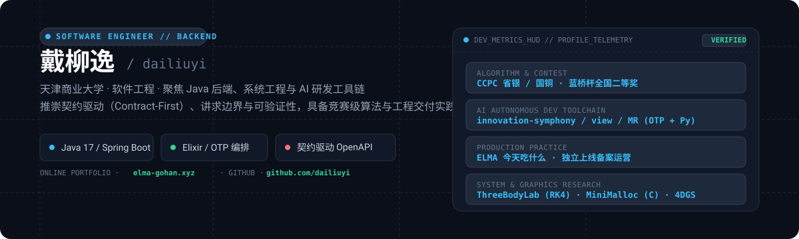

# 戴柳逸 / dailiuyi

  

  <strong>天津商业大学 · 软件工程 2024 级 · Java 后端开发</strong>

  <a href="https://elma-gohan.xyz"><strong>个人主页与博客</strong> (elma-gohan.xyz)</a> ·
  <a href="https://github.com/dailiuyi"><strong>GitHub</strong> (dailiuyi)</a> ·
  <strong>邮箱</strong>：<a href="mailto:d1753262762@gmail.com">d1753262762@gmail.com</a>

---

## 实习经历

### 长沙市规划信息服务中心 · Java 后端开发实习生

`2026.06 - 至今` · 技术栈：Spring Boot 2.7 / MyBatis-Plus / PostgreSQL / Apache POI (SXSSF)

- **通用政务数据导出组件**：依据既有项目架构文档、数据库表结构与接口契约，独立负责政务通用数据导出组件的后端设计与编码。采用 `model/core/starter/client/web` 五模块 Maven 体系，完成 6 张业务表对应的数据访问层、核心业务逻辑与 21 个 REST API 接口，既支持作为独立 Standalone 微服务运行，也可通过自定义 Spring Boot Starter 无缝嵌入各业务系统。目前后端编码已完成，正在配合前端联调与测试验收。
- **异构多数据源接入**：统一支持 REST API 与低代码数据集两类输入源。API 接入方式支持 GET / POST / PUT 请求及自定义请求头、URL 查询参数和请求体透传；调用前严格校验目标服务地址白名单，并基于分页协议循环分批拉取；支持通过 `dataPath` 表达式动态定位 JSON 响应体中的目标列表，平铺展开多层嵌套字段为平面 Excel 结构。
- **高性能 Excel 导出与内存保护**：基于 Apache POI SXSSF 实现流式写入与动态表头构建，支持“既定 Excel 模板按占位符填充”与“依据字段元数据动态生成单/多级表头”两种模式；引入全链路分页取数与边读边写机制，并设置单次 50 万行硬性保护阈值，彻底规避大数据量导出时的 JVM OOM 内存风险。
- **模板表头智能自动对齐**：导入新 Excel 模板时，系统自动建立表头列与业务字段的映射关系：优先进行完全匹配，未命中时依次降级至关键词包含、拼音首字母缩写和余弦近似度匹配；每个系统字段严格限制单列绑定，对无法确信判定的歧义列保留人工二次交互映射。
- **模板生命周期管理**：提供 Excel 模板文件的上传、下载、数据预读取和在线编辑回写接口；上传链路执行 MIME 类型探测与 10MB 大小硬限制校验，计算并存盘 MD5 完整性摘要，文件流以 BYTEA 二进制类型安全持久化至 PostgreSQL。

### 湖南星鹏应急安全科技有限公司 · 运维实习生

`2025.06 - 2025.09`

- **容器化部署与发布验证**：遵循既有运维规范与系统部署流水线，使用 Docker 完成应用服务的配置装配、多容器编排发布、版本平滑更新与健康检查验证，熟悉生产环境下的版本交付与基线验证流程。
- **日常巡检与线上故障定位**：参与基础设施日常巡检，协助完成核心 Web 静态资源的 CDN 加载分流与缓存优化；结合系统资源监控指标、应用运行日志及网络配置，快速排查并定位常见服务异常。

---

## 项目经历

### 团队研发工具链：AI 自主编码与研发效能工程

`2026.08 - 至今` · 技术栈：Elixir / OTP、Python 3.11、Spring Boot 3、Unity C# · 角色：核心代码开发

围绕“让 AI Agent 自主、可靠地认领并完成研发任务”的目标，建设了一套涵盖任务编排、过程可观测、业务承载平台与网络协议工程四层结构的工程工具链：

#### 1. [innovation-symphony](https://github.com/dailiuyi/innovation-symphony) — 多仓库自主编码编排框架
- **OTP 状态机架构**：核心基于 Elixir/OTP 构建（核心代码库约 2.2 万行，包含 51 个 ExUnit 测试文件）。自动监听 GitHub / GitLab 上标记为 `ready` 的 Issue，调度 Agent 认领任务、自动化编码，经由严苛的独立评审门禁与测试检查后以 Draft PR 交付。内置 0～5 次返工预算限制与故障自愈状态机，并设立独立的看门狗进程负责异常兜底。
- **环境隔离与结构化验收**：支持在 Issue 评论区动态指定调度模型；代码的运行验证与 Lint 检查均运行在 Linux 隔离沙箱环境中；测试结果经由结构化 AST 与正则逐项比对判定，杜绝“仅凭大模型自评”带来的幻觉风险。
- **契约与工程纪律**：沉淀 20 余篇工程规格文档（决策日志 `DECISIONS.md`、需求规格、Issue 通信协议、返工判定矩阵等），所有增量演进均附带编号与验证证据，真实跑通了“Issue #3 ➔ 自动诊断 ➔ 独立代码评审 ➔ 产出 Draft PR #4”的端到端无人值守闭环。

#### 2. [innovation-view](https://github.com/dailiuyi/innovation-view) — Symphony 只读可观测看板
- **轻量可观测看板**：为 Symphony 运行时量身定制 Linear 风格的极简只读看板，提供任务四态视图（待关注 / 进行中 / 待评审 / 已交付）、Agent 会话轨迹与角色动态过滤，以及 Agent 实时上下文检查器（提示词、近期终端输出、转录记录分页搜索）。
- **纯标准库零冗余依赖**：基于 Python 3.11 标准库实现数据采集、内存缓存、REST 接口与页面渲染，原生兼容 WSL 与 Linux 数据拉取链路；包含完备的单测覆盖与 Playwright 自动化冒烟测试；明确安全边界（只读设计、无鉴权、专供内网环境）。

#### 3. [innovation-ar-resource-platform](https://github.com/dailiuyi/innovation-ar-resource-platform) — AR 场景资源管理平台
- **企业级全栈工程**：基于 RuoYi + Spring Boot 3 多模块架构（后端 287 个 Java 文件）与 Vue 3 前端（101 个 `.vue` 组件），搭配 PostgreSQL 与 Docker Compose 编排。提供场景资源上传、在线 3D 预览、版本发布与终端扫码下载的全流程支撑。
- **版本冻结与对账闭环**：确立“场景 ➔ 版本草稿 ➔ 多文件分片校验与上传 ➔ 启动对账”的一致性链路，严格保证每个场景仅存在一个处于激活状态的“当前发布版本”，发布后其关联资源自动只读冻结。
- **契约优先设计**：严格遵循 OpenAPI v0.3.0 接口规范与清单 JSON Schema，配套 42 篇编号规格文档，在数据库表设计、契约校验、浏览器兼容性、密钥扫描与 SDK 接入各阶段均留存可验证的 JSON 证据链。

#### 4. [innovation-MR](https://github.com/dailiuyi/innovation-MR) — Unity MR 局域网联机 UPM 扩展包
- **可复用联机组件**：基于 Unity 6 与 Netcode for GameObjects 2.12 开发的通用 Unity 扩展包（`com.innovationmr.ngo-lan`，支持通过 Git URL 一键接入），实现轻量级 UDP 局域网主机广播与房间自动发现加入功能。
- **网络协议防伪与健壮性**：坚持协议防御性设计原则，建立连接的目标 IP 严格取自底层 UDP 数据报文源地址，绝不信任广播 JSON 内部的伪造字段；引入 Magic 字节头与版本号强校验；网络端口强制钳制在 `1..65535` 有效区间内；对会话缓存、数据包队列与信令尺寸施加硬上限，并通过 `ConnectionApprover` 委托提供可插拔的安全鉴权钩子。

---

### [ELMA · 家今天的饭](https://github.com/dailiuyi/elma-gohan)

`2026.08 - 至今` · 独立主导 · 个人产品

技术栈：Java 17 / Spring Boot 3.5 / Spring Data JPA / PostgreSQL / uni-app / Vue 3 / TypeScript

- **独立产品全链路闭环**：针对日常就餐决策困难的痛点，提出“单次只推荐一家不易踩坑餐厅”的极简决策逻辑。独立主导竞品调研、交互设计、后端 API 开发、前端跨端实现、自动化测试与线上备案，完成从想法到真实用户使用的完整交付闭环。
- **AI 深度协同研发实践**：使用大模型辅助前期的竞品调研与领域模型抽象，由 AI Agent 辅助完成模块编码与迭代。本人负责领域边界划分、架构方案取舍、代码审查及异常纠正，配合后端 51 个 JUnit 5 测试用例与 Vitest 前端单测，确保高可靠交付。
- **生产环境部署与运维**：完成 Spring Boot API 与 PostgreSQL 实例在阿里云 ECS 的容器化部署，打通域名 ICP 备案与微信小程序备案；配置 OpenClaw 实现关键 API 自动化周期巡检与健康告警。

---

### [Three Body Lab（三体参数实验室）](https://github.com/dailiuyi/ThreeBodySimulation) · [在线演示](https://threebody.elma-gohan.xyz/)

`2026.02 - 至今` · 独立主导 · 个人项目

技术栈：Java 17 / Spring Boot / REST / WebSocket / Vue 3 / TypeScript / Three.js

- **纯 Java 高可信物理计算核**：将 RK4 积分、N 体引力模型与 Plummer 软化长度封装为零框架依赖的纯 Java 模块；实时监控能量漂移、角动量漂移与天体最小间距，确保数值计算结果的物理可信度。
- **非阻塞 WebSocket 限流架构**：按墙钟时间对高频画面快照与物理轨迹进行 60 Hz 限流，对诊断指标执行 2 Hz 限流；展示类消息采用“最新覆盖”策略，任务控制指令严格保序发送；网络 I/O 运行在独立线程池，绝不反压物理计算线程。
- **单 Worker 任务编排与状态一致性**：通过单 Worker 串行任务队列彻底消除计算竞争；支持暂停、恢复、单步、取消及异常停机降级恢复；历史实验采用原子替换写入归档文件。
- **契约驱动与多视角可视化**：基于 OpenAPI 与 WebSocket JSON Schema 统一前后端数据契约，提供 2D/3D 双重视角渲染、相空间轨迹图表分析与报告导出，配套有详尽的[公网部署复盘文档](https://github.com/dailiuyi/ThreeBodySimulation/blob/main/docs/PUBLIC_DEPLOYMENT_POSTMORTEM.md)。

---

### [MiniMalloc](https://github.com/dailiuyi/minialloc) — 独立堆内存分配器

在 8KB 静态连续内存空间上独立实现标准 `malloc` / `free` 内存分配与回收接口，完全脱离系统堆环境运行。

- **内存碎片抑制策略**：基于首次适应算法（First-Fit）、动态块切割、地址有序显式空闲链表以及前后相邻块双向合并机制，有效抑制外部碎片膨胀。
- **跨平台与内存对齐安全**：使用 `uintptr_t` 与 `size_t` 统一指针算术运算，实现严格的 8 字节边界对齐、惰性堆初始化与双向块头安全转换。
- **完备的边界缺陷回归测试**：设计 12 个典型工况场景与 47 项严格断言，专项覆盖并修复了 64 位指针溢出截断、尾哨兵虚高 16 字节、以及 `heap_init` 重置时空闲容量计算偏差等底层隐患。

---

### 其它代表性项目

- **[TCG 卡牌 PDF 打印工具](https://github.com/dailiuyi/tcg-card-pdf)**：按毫米物理尺寸排版并生成标准 A4 打印 PDF，提供直观的 GUI、CLI 与开箱即用的 Windows 可执行程序。
- **[tjcu8 静态站渐进式重构](https://github.com/dailiuyi/tjcu8)**：五页经典站点的阶梯式现代化重构示范（原生 HTML ➔ CSS 结构分层 ➔ JS 模块化 ➔ Vite 打包 ➔ Vue 3 共享母版），全程留存详实的设计阶段文档。
- **[Utopia-UI-design](https://github.com/dailiuyi/Utopia-UI-design)**：针对 Unity 6 MR 游戏沉浸式交互界面的 UI 设计套件，以 Agent Skill 形式封装设计 Token 与规范指南，供 AI Agent 自动化适配调用。
- **个人博客系统**：基于 Astro 独立搭建（开发自研 rehype / remark 渲染增强插件、中文字体动态子集化压缩，并搭配自建 Go 访问统计服务）。

---

## 算法竞赛荣誉

- **CCPC（中国大学生程序设计竞赛）**：
  - 第十届 CCPC 河北省赛银牌、全国决赛铜牌
  - 第九届 CCPC 河北省赛铜牌、全国决赛铜牌
- **蓝桥杯全国软件和信息技术专业人才大赛**：
  - 第十七届、第十六届蓝桥杯软件类 C/C++ 大学 B 组全国二等奖、省级一等奖
- **全国青少年信息学奥林匹克联赛 (NOIP)**：
  - 初中、高中阶段多次荣获 NOIP（湖南赛区）省级提高组二等奖

---

## 技术技能清单

| 领域方向 | 核心技能与技术选型 |
| :--- | :--- |
| **编程语言** | Java 17、SQL、C / C++、Python 3.11、Elixir、C#、TypeScript |
| **后端框架与中间件** | Spring Boot 2.7 / 3.x、MyBatis-Plus、Spring Data JPA、PostgreSQL、REST、WebSocket、Flyway、Caffeine |
| **系统与批处理组件** | Apache POI (SXSSF)、OTP 监督树与状态机 (Elixir)、系统内存对齐 (C) |
| **契约工程与质量保障** | OpenAPI 3.0、JSON Schema、JUnit 5、ExUnit、Vitest、Playwright、unittest |
| **前端与数据可视化** | Vue 3、TypeScript、uni-app、Pinia、Three.js、HTML5 Canvas |
| **基础设施与运维** | Docker、Docker Compose、Linux (Ubuntu / WSL)、NGINX、systemd、HTTPS / SSL、阿里云 ECS |
| **扩展平台与开发工具** | Unity 6 (Netcode for GameObjects)、Astro、Git、Git Worktree、Maven |
| **AI 协同研发工程** | ChatGPT、Grok、Codex、Claude Code、OpenClaw（自主研发流水线设计、提示词工程与自动化门禁验收） |
